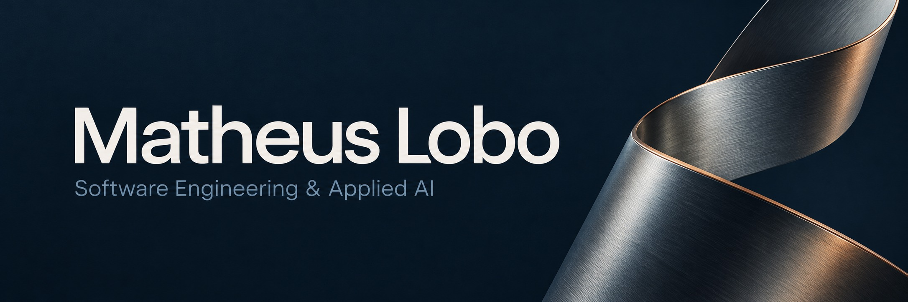

  

  <strong>Engenheiro de software · Fundador da Korventi Technologies · CTO e cofundador da WebFrete</strong>

  <a href="https://www.linkedin.com/in/matheuslobocamara/">LinkedIn</a>
  &nbsp; / &nbsp;
  <a href="https://korventi.vercel.app/">Korventi Technologies</a>
  &nbsp; / &nbsp;
  <a href="mailto:matheusloboo2001@gmail.com">Contato</a>

 

## Do problema de negócio ao software em produção

Sou **Matheus Lobo**, engenheiro de software em Cuiabá, MT. Construo produtos digitais de ponta a ponta: arquitetura, APIs, aplicações web e mobile, integrações e infraestrutura.

Na **[Korventi Technologies](https://korventi.vercel.app/)**, desenvolvo software e soluções de IA para operações de negócio. Na **[WebFrete](https://webfrete.com/)**, atuo como CTO e cofundador, conduzindo arquitetura e desenvolvimento da plataforma.

Meu foco: entender o domínio, simplificar a operação e entregar sistemas que possam ser mantidos e evoluídos.

## Projetos em destaque

### AMMT · Associação Médica de Mato Grosso

Ecossistema digital para a associação: **site de eventos, venda de ingressos, pagamentos via PIX e ingressos com QR code**, além da Copa AMMT, com jogos, classificação, artilharia e votação. O projeto também reúne API, painel administrativo e aplicativo em desenvolvimento.

**Engenharia:** Next.js, TypeScript, FastAPI e React Native / Expo.

[Conhecer o projeto · eventosammt.com.br](https://eventosammt.com.br/)

### WebFrete

Plataforma de transporte rodoviário que conecta empresas e caminhoneiros. **CTO e cofundador**, com atuação em arquitetura, APIs, aplicações web e mobile, segurança e integrações fiscais.

**Engenharia:** FastAPI, Next.js, PostgreSQL, Redis, Docker e Flutter.

[Conhecer a plataforma · webfrete.com](https://webfrete.com/)

### KR Mecânica

Catálogo digital de **peças para máquinas pesadas e agrícolas**, com navegação por produto e solicitação de cotação pelo WhatsApp. Desenvolvimento da presença digital e da experiência de busca de peças.

[Explorar o catálogo · krmecanicakr.com.br](https://krmecanicakr.com.br/)

## Código e arquitetura

- **[DDD Structure](https://github.com/LoboProgrammingg/DDD-Structure)** — Base Python com DDD, Clean Architecture, eventos de domínio, testes e CI.
- **[Tacto System](https://github.com/LoboProgrammingg/Tacto-System)** — Automação de restaurantes, pedidos e mensageria com IA, FastAPI e PostgreSQL.
- **[I.R.I.S.](https://github.com/LoboProgrammingg/I.R.I.S)** — Assistente financeiro via WhatsApp para gestão de boletos e cobranças, com FastAPI, Celery e Redis.

## Tecnologias e prática

| Área | Ferramentas e abordagem |
| :--- | :--- |
| Backend | Python, FastAPI, PostgreSQL, Redis e Celery |
| Web e mobile | TypeScript, React, Next.js, React Native / Expo e Flutter |
| IA aplicada | LangGraph, LangChain, agentes, RAG e busca vetorial |
| Arquitetura | DDD, Clean Architecture, APIs e integrações |
| Operação | Docker, CI/CD, testes automatizados e observabilidade |

 

**Vamos conversar sobre seu próximo produto.** 
Arquitetura de software, plataformas digitais e IA aplicada a negócios.

[LinkedIn](https://www.linkedin.com/in/matheuslobocamara/) &nbsp; / &nbsp; [matheusloboo2001@gmail.com](mailto:matheusloboo2001@gmail.com)
